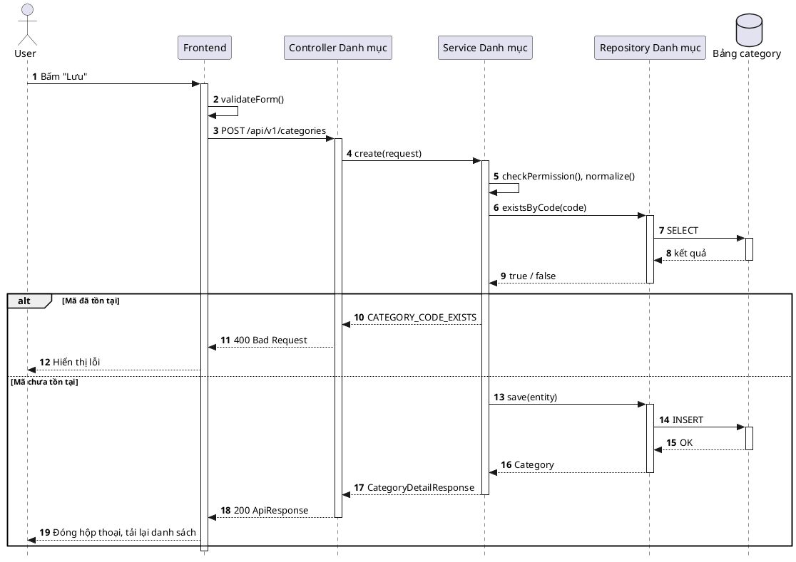

# CtV Flow Tracer — Tài liệu tổng quan dự án

> **Đề tài:** AI Code-to-Visual Flow Tracer — Công cụ phân tích mã nguồn tĩnh và trực quan hóa luồng xử lý End-to-End, phục vụ onboarding, phát triển và chuyển đổi (migration) phần mềm
> **Chương trình:** Viettel Digital Talent 2026 — Giai đoạn 2
> **Tác giả:** Đỗ Trung Quân
> **Phiên bản tài liệu:** 1.1 — 30/09/2026
> **Trạng thái dự án:** Đã chốt phạm vi và kiến trúc, chưa bắt đầu viết code

---

## Cách đọc tài liệu này

Tài liệu này là **nguồn sự thật (source of truth)** về bài toán, phạm vi và kiến trúc của dự án. Nó được viết để một người mới hoặc một AI agent mới đọc xong là hiểu dự án và sẵn sàng đóng góp. Chi tiết từng phần nằm ở các tài liệu đi kèm:

| Tài liệu                                                      | Nội dung                                                                                                                |
| :--------------------------------------------------------------| :------------------------------------------------------------------------------------------------------------------------|
| [overview.md](overview.md) *(tài liệu này)*                   | Bài toán, phạm vi, yêu cầu phi chức năng, kiến trúc, mô hình dữ liệu trung gian, kịch bản hoạt động, chính sách dùng AI |
| [feature_list.md](feature_list.md)                            | Danh sách **chức năng** chia theo nhóm mục đích, kèm mức ưu tiên và quy tắc xử lý                                       |
| [API_list.md](API_list.md)                                    | Danh sách **API nội bộ** (Engine ↔ Web UI), chia nhóm tương ứng với nhóm chức năng                                      |
| [database.md](database.md)                                    | Thiết kế **cơ sở dữ liệu**: mô tả từng bảng và từng cột                                                                 |
| [docs/diagrams/database.dbml](../docs/diagrams/database.dbml) | **Sơ đồ CSDL** dạng DBML (xem trên dbdiagram.io)                                                                        |
| [project_structure.md](project_structure.md)                  | Cấu trúc thư mục mã nguồn của dự án, ý nghĩa từng folder/file                                                           |
| [roadmap.md](roadmap.md) *(sẽ bổ sung)*                       | Lộ trình theo từng phase                                                                                                |
| [CLAUDE.md](../CLAUDE.md)                                     | Quy tắc bắt buộc khi AI agent (Claude Code) đóng góp vào dự án                                                          |
| `docs/progress/` *(sẽ bổ sung)*                               | Nhật ký công việc đã làm, mỗi phase trong roadmap một file                                                              |

| Bạn là… | Nên đọc theo thứ tự |
| :--- | :--- |
| Người mới muốn hiểu đề tài | §0 → §1.1 → §1.2 → §2.1 → §2.4 → Phụ lục A |
| Dev chuẩn bị viết code | §0 → §2.1 → §2.2 → feature_list.md → API_list.md → database.md |
| AI agent | `CLAUDE.md` → §0 → §2.1 → §2.2 → §2.7 → tài liệu chi tiết của phần đang làm |
| Người review / mentor | §0 → §1.2 → §1.3 → §1.4 → roadmap.md |

---

## 0. Tóm tắt nhanh (TL;DR)

- **Vấn đề:** Muốn hiểu một luồng nghiệp vụ (bấm nút này thì chuyện gì xảy ra, đi qua những lớp nào, ghi vào bảng nào), dev phải lần qua hàng chục file ở hai repo FE và BE. Tài liệu thường thiếu hoặc lỗi thời. Dự án migrate từ hệ thống cũ còn khó hơn vì phải đối chiếu logic cũ và mới.
- **Giải pháp:** Một **Web UI** kết nối vào mã nguồn dự án. Tool **phân tích tĩnh** (đọc code, không chạy code) để dựng **cây API Backend**, **cây thành phần Frontend** và **sequence diagram End-to-End** cho từng endpoint hoặc từng nút bấm. Tool cũng sinh **phần diễn giải dễ hiểu** kèm **dữ liệu mẫu**.
- **Giao diện 3 cột:** trái là cây BE/FE, giữa là canvas diagram, phải là panel 2 tab "Diễn giải" và "Kịch bản".
- **Lõi (MVP):** Java Spring Boot + Angular. **Mở rộng:** PHP (hệ thống cũ) dùng cho split view so sánh cũ và mới, Flowchart, nhóm chức năng, xác minh runtime.
- **Nguyên tắc vàng:** diagram luôn do **phân tích tĩnh sinh ra một cách tất định**. **AI chỉ dùng khi bắt buộc**: diễn giải mục đích, làm mượt câu kịch bản, chọn giữa các ứng viên khi phân tích tĩnh không chắc chắn.
- **Kiến trúc:** `Analysis Engine` (Java 21 + Spring Boot) + `Node Analyzer` (sidecar Node.js để phân tích Angular) + `Web UI` (Angular) + `PostgreSQL`, đóng gói bằng Docker Compose. Đây là **tool cá nhân**: mỗi người tự chạy trên máy của mình.
- **AI:** qua lớp Provider trừu tượng. Mặc định dùng **Gemini**, có thể đổi sang Claude, API tương thích OpenAI, hoặc tắt hẳn AI.

---

# 1. Pha phân tích yêu cầu

## 1.1 Tổng quan hệ thống

### 1.1.1 Bối cảnh và vấn đề

Trong phát triển phần mềm doanh nghiệp, **onboarding** (tiếp nhận dự án mới, tiếp quản module lạ) là giai đoạn tốn thời gian nhất. Hệ thống hiện đại thường tách rời hoàn toàn: Frontend Angular ở một repo, Backend Spring Boot ở repo khác. Để hiểu **một** luồng nghiệp vụ End-to-End, lập trình viên phải:

1. Tìm nút bấm trong HTML template, lần sang hàm xử lý trong component TypeScript.
2. Đi qua facade/service/repository phía FE để tìm lời gọi HTTP và URL thật (thường ghép từ hằng số, cấu hình môi trường, luật proxy).
3. Sang repo BE, tìm Controller khớp URL, rồi lần qua Service, Repository, câu truy vấn, Entity và bảng dữ liệu.
4. Tự ghép tất cả trong đầu hoặc trên giấy.

Việc này tạo **gánh nặng nhận thức lớn**, dễ sót nhánh xử lý, và phải lặp lại với mỗi người mới. Trong các **dự án chuyển đổi** (ví dụ từ hệ thống PHP cũ sang Angular + Spring Boot), còn thêm một câu hỏi khó: *luồng mới đã giữ đủ logic của luồng cũ chưa?*

### 1.1.2 Giải pháp và giá trị mang lại

**CtV Flow Tracer** là một công cụ web chạy cục bộ. Nó đọc mã nguồn dự án và:

- **Dựng bản đồ**: danh sách API theo module (tương tự Swagger) và danh sách thành phần tương tác trên FE theo màn hình, tab, form.
- **Vẽ luồng End-to-End**: người dùng chọn một endpoint hoặc một nút, tool vẽ ngay sequence diagram từ giao diện xuống tới bảng dữ liệu.
- **Giải thích bằng lời**: mục đích, đầu vào, đầu ra, ràng buộc, kịch bản từng bước, và dữ liệu mẫu sinh từ DTO/Entity trong code.
- **Minh bạch độ tin cậy**: mọi mũi tên trên diagram có nhãn cho biết tool *chắc chắn* hay *suy luận*, và mọi node đều trỏ được về `file:dòng` trong code.

Giá trị: rút ngắn thời gian onboarding, giảm sai sót khi sửa code (biết một nút bấm tác động tới dữ liệu nào), hỗ trợ đối soát nghiệp vụ khi migrate, và tạo tài liệu kiến trúc "sống" (luôn khớp với code hiện tại).

### 1.1.3 Phạm vi

| Hạng mục | Trong phạm vi MVP | Mở rộng (làm sau MVP) | Ngoài phạm vi |
| :--- | :--- | :--- | :--- |
| Backend | Java 17+, Spring Boot 3.x (Spring MVC REST, Spring Data JPA, JPQL/SQL viết tay) | PHP (framework tự viết của hệ thống cũ) cho so sánh cũ/mới; ZK; NestJS; Laravel… | Ngôn ngữ không có bộ phân tích |
| Frontend | Angular 15+ (đích chính: Angular 21, standalone components, Native Federation microfrontend) | React, Vue… | — |
| Diagram | Sequence diagram | Flowchart (luồng rẽ nhánh bên trong logic) | — |
| Nguồn code | Thư mục trên máy (khai báo qua Web UI) | Upload `.zip`, Git URL, CLI cho CI | — |
| Người dùng | Một người, trên máy cá nhân (Docker Compose) | — | Nhiều người dùng chung một hệ thống; dịch vụ SaaS |
| Dữ liệu thật | **Không bao giờ** truy cập DB hay dữ liệu thật của dự án được phân tích | — | — |

**Dự án demo:** một dự án nội bộ có thật, gồm BE Spring Boot, FE Angular microfrontend, và mã PHP của hệ thống cũ nằm bên trong repo BE. Mô tả chi tiết (đã ẩn định danh) ở **Phụ lục B**. Mã nguồn dự án demo **không bao giờ được đưa vào repo này**.

### 1.1.4 Thuật ngữ

| Thuật ngữ | Nghĩa trong dự án |
| :--- | :--- |
| **Workspace** | Một "dự án" trong tool: tập hợp nhiều Source được phân tích cùng nhau (ví dụ repo BE, repo FE và phần mã cũ). |
| **Source** | Một thư mục mã nguồn có **vai trò** (`BACKEND`, `FRONTEND`, `LEGACY`), kèm danh sách thư mục loại trừ. Vai trò do tool **tự nhận diện** từ dấu hiệu dự án (`pom.xml`, `angular.json`…), người dùng không phải chọn. Source khai báo theo **thư mục**, không theo repo, và có thể lồng nhau. |
| **Stack detection** | Bước tự nhận diện công nghệ của Source (qua `pom.xml`, `angular.json`, …) để chọn Adapter phù hợp. |
| **Adapter** | Bộ phân tích cho một công nghệ cụ thể (Spring, Angular, PHP-legacy…), dạng plugin. Đầu ra của Adapter là IR. |
| **IR (Intermediate Representation)** | Mô hình dữ liệu trung gian dạng **graph** (Node + Edge) chung cho mọi ngôn ngữ. Đây là "bản đồ" của Workspace. |
| **Node / Edge** | Node là một thành phần (nút bấm, method, endpoint, bảng…). Edge là quan hệ giữa hai node (kích hoạt, gọi, gửi HTTP, đọc/ghi…). |
| **Node key** | Định danh **ổn định** của node qua các lần quét (ví dụ `java:method:com.acme.CategoryService#create(CategoryReq)`). Dữ liệu người dùng luôn tham chiếu bằng key, không bằng id. |
| **Linker** | Bước nối lời gọi HTTP ở FE với endpoint ở BE bằng cách chuẩn hóa và so khớp URL. |
| **Tracer** | Thuật toán đi trên graph từ một node xuất phát để thu được chuỗi bước End-to-End. |
| **Trace** | Kết quả của Tracer: danh sách participant và các bước có thứ tự. Trace là đầu vào để vẽ diagram và sinh kịch bản. |
| **Confidence (mức tin cậy)** | Nhãn trên mỗi Edge: `CERTAIN`, `INFERRED`, `UNRESOLVED` (và `RUNTIME_VERIFIED` ở bản mở rộng). Liên kết người dùng đã chốt tay hiển thị riêng là "Chốt tay". |
| **Link override** | Quyết định chốt tay của người dùng cho một liên kết (ghim hoặc loại bỏ). Được lưu lại và áp dụng cho các lần quét sau. |
| **Feature (Nhóm chức năng)** | *(Mở rộng)* Nhóm các endpoint/thành phần liên quan, được lưu lại để xem diagram và diễn giải ở cấp chức năng. |
| **Scenario (Kịch bản)** | Lời kể từng bước của sequence diagram, dạng "Bước n: A làm gì tới B". Bước n khớp đúng mũi tên số n trên diagram. |

## 1.2 Yêu cầu chức năng

Toàn bộ chức năng (72 chức năng, 9 nhóm) được mô tả chi tiết trong **[feature_list.md](feature_list.md)**: tên, mức ưu tiên, input, output, mô tả, cùng quy tắc xử lý của từng nhóm. API tương ứng nằm trong **[API_list.md](API_list.md)**.

Tổng quan các nhóm:

| Nhóm | Mục đích | MVP | Nên có | Mở rộng |
| :--- | :--- | :---: | :---: | :---: |
| 1. Quản lý Workspace & nguồn mã | Khai báo dự án và các thư mục mã nguồn cần phân tích | 9 | 0 | 3 |
| 2. Quét & phân tích mã nguồn | Đọc code, dựng "bản đồ" thành phần, quét lại khi code đổi | 8 | 0 | 4 |
| 3. Khám phá cấu trúc dự án | Xem cây API Backend, cây thành phần Frontend, tìm kiếm, xem code | 4 | 2 | 0 |
| 4. Dò vết & trực quan hóa luồng | Dò luồng End-to-End và vẽ sequence diagram tương tác | 5 | 1 | 1 |
| 5. Liên kết Frontend – Backend & độ tin cậy | Nối FE với BE, thể hiện mức tin cậy, chốt tay, xác minh runtime | 6 | 0 | 2 |
| 6. Diễn giải & dữ liệu mẫu | Panel phải: tab Diễn giải và tab Kịch bản | 10 | 0 | 0 |
| 7. Nhóm chức năng (Feature) | Gom nhiều thành phần thành một chức năng để xem tổng thể | 0 | 0 | 8 |
| 8. So sánh & đối chiếu hệ thống cũ – mới | Split view, ghép luồng cũ/mới, danh sách khác biệt khi migrate | 0 | 0 | 4 |
| 9. Cấu hình AI & hệ thống | Cấu hình AI, bộ lọc nhiễu, theo dõi sử dụng AI | 4 | 1 | 0 |
| **Tổng** | | **46** | **4** | **22** |

## 1.3 Yêu cầu phi chức năng

| ID | Nhóm | Yêu cầu | Chỉ tiêu |
| :--- | :--- | :--- | :--- |
| NFR-01 | Hiệu năng | Quét lần đầu một Workspace khoảng 2.000 file nguồn | ≤ 3 phút |
| NFR-02 | Hiệu năng | Quét lại khi ≤ 20 file thay đổi | ≤ 15 giây |
| NFR-03 | Hiệu năng | Tải cây BE/FE; tìm kiếm | ≤ 1 giây |
| NFR-04 | Hiệu năng | Dò vết và vẽ trace ≤ 50 bước (không tính AI) | ≤ 2 giây |
| NFR-05 | Hiệu năng | Diễn giải AI lần đầu / đã cache | Chữ đầu tiên ≤ 5 giây, hoàn tất ≤ 20 giây (có streaming) / ≤ 1 giây |
| NFR-06 | Tài nguyên | RAM của Engine khi quét Workspace khoảng 2.000 file | ≤ 2 GB |
| NFR-07 | Độ chính xác | Phát hiện endpoint so với OpenAPI | ≥ 98% (mục tiêu 100%) |
| NFR-08 | Độ chính xác | Liên kết FE → BE so với ground truth | Precision ≥ 95%, recall ≥ 85% |
| NFR-09 | Độ chính xác | Trace đầy đủ, đúng tới bảng dữ liệu (mẫu 30 luồng) | ≥ 90% |
| NFR-10 | Tính tất định | Cùng mã nguồn và cấu hình thì luôn cho cùng IR và cùng diagram | Bắt buộc (có golden test) |
| NFR-11 | Bảo mật | Chỉ **đọc** mã nguồn; không build, không chạy, không cài dependency của dự án được phân tích | Bắt buộc |
| NFR-12 | Bảo mật dữ liệu | Không kết nối DB và không đọc dữ liệu thật của dự án. Dữ liệu mẫu chỉ sinh từ DTO | Bắt buộc |
| NFR-13 | Bảo mật AI | Được gửi **mã nguồn** tới AI bên ngoài (Gemini, Claude…) theo thực tế team đang dùng. **Trước khi gửi phải che secret**: giá trị của khóa chứa `password`, `secret`, `token`, `key`, `credential` trong `application*.yml`/`.properties`/`.env`, chuỗi kết nối DB, private key. Không gửi file `.env`, keystore, file dữ liệu | Bắt buộc |
| NFR-14 | Bảo mật AI | Chỉ dùng **API chính thức** (trả phí hoặc gói doanh nghiệp) có cam kết không dùng dữ liệu để huấn luyện; không dùng giao diện chat miễn phí | Bắt buộc |
| NFR-15 | Bảo mật | API key chỉ nằm trong biến môi trường của Engine, không lưu vào DB, không gửi xuống trình duyệt, không ghi log | Bắt buộc |
| NFR-16 | Bảo mật | Mặc định Engine chỉ lắng nghe `127.0.0.1`; trình duyệt thư mục bị giới hạn trong `SOURCE_ROOT` và chặn path traversal | Bắt buộc |
| NFR-17 | Kiểm toán | Ghi log mỗi lần gọi AI: mục đích, provider, model, số token, độ trễ, trạng thái. **Không lưu nội dung prompt** mà chỉ lưu hash | Bắt buộc |
| NFR-18 | Độ tin cậy | Tool vẫn hoạt động đầy đủ, trừ phần diễn giải AI, khi AI tắt, hết quota hoặc mất mạng | Bắt buộc |
| NFR-19 | Độ tin cậy | File lỗi cú pháp không làm hỏng lần quét (trạng thái `PARTIAL` kèm danh sách lỗi) | Bắt buộc |
| NFR-20 | Chi phí AI | Mỗi node gọi AI tối đa một lần cho mỗi phiên bản code (cache theo hash). Giới hạn token cho mỗi lời gọi; có hạn mức ngày cấu hình được | Bắt buộc |
| NFR-21 | Mở rộng | Thêm công nghệ mới bằng cách viết Adapter mới, **không sửa phần lõi** | Kiến trúc plugin |
| NFR-22 | Khả dụng | Giao diện và nội dung diễn giải bằng tiếng Việt (tên định danh trong code giữ nguyên). Hỗ trợ trình duyệt Chrome/Edge/Firefox bản mới | — |
| NFR-23 | Triển khai | Khởi chạy bằng một lệnh `docker compose up`, cấu hình qua `.env`. Chạy được trên Windows (Docker Desktop) và Linux | — |
| NFR-24 | Bảo trì | Unit test cho từng Adapter, golden test cho IR của các fixture, CI chạy lint và test mỗi PR. Độ phủ test của phần lõi ≥ 70% | — |

## 1.4 Tiêu chí hoàn thành MVP (Definition of Done)

MVP được coi là hoàn thành khi đáp ứng đủ các điều kiện sau:

1. `docker compose up` trên một máy sạch, rồi tạo Workspace, khai báo Source BE + FE của dự án demo và quét thành công qua Web UI.
2. Cây BE và cây FE hiển thị đầy đủ, đạt NFR-07.
3. Chọn bất kỳ nút nào có gọi API: sequence diagram hiển thị luồng từ Người dùng tới Bảng dữ liệu; tab Diễn giải và tab Kịch bản đầy đủ theo Nhóm 6 trong [feature_list.md](feature_list.md).
4. Các chỉ tiêu NFR-01 → NFR-09 được đo và ghi kết quả vào `docs/evaluation.md` (chỉ ghi số liệu tổng hợp, không ghi code của dự án demo).
5. Tắt AI (`LLM_PROVIDER=none`) thì mọi chức năng trừ phần do AI sinh vẫn hoạt động.
6. Golden test và unit test chạy xanh trên CI.

## 1.5 Phạm vi người dùng

Đây là **tool cá nhân**: mỗi người tự chạy tool trên máy mình bằng Docker Compose. Không có đăng nhập hay phân quyền; người chạy tool có toàn quyền trên các Workspace của mình.

| Chân dung | Nhu cầu chính | Chức năng hay dùng |
| :--- | :--- | :--- |
| **Dev mới onboard** | Nắm nhanh bức tranh tổng thể và các luồng chính | Cây BE/FE, sequence, tab Kịch bản |
| **Dev Frontend** | Biết nút bấm gọi API nào, gửi gì và nhận gì | Dò vết từ FE, Đầu vào/Đầu ra JSON, dữ liệu mẫu |
| **Dev Backend / Tech lead** | Hiểu logic và tác động dữ liệu của API trước khi sửa; biết FE nào đang phụ thuộc | Dò vết từ endpoint, "Được gọi từ", Ràng buộc |
| **BA / QA** | Hiểu nghiệp vụ và các nhánh lỗi để viết test case | Tab Diễn giải, Kịch bản, nhánh lỗi trên diagram |
| **Team migration** | Đối chiếu luồng cũ (PHP) và luồng mới | Split view, danh sách khác biệt (Nhóm 8, mở rộng) |

---

# 2. Pha thiết kế hệ thống

## 2.1 Thiết kế kiến trúc

### 2.1.1 Tổng quan

Hệ thống gồm ba thành phần chạy trong một container, cộng một CSDL, đóng gói bằng Docker Compose:

- **Analysis Engine** ("người đọc code") — **Java 21 + Spring Boot**: đọc mã nguồn, dựng graph IR, lưu vào DB và phục vụ API cho UI. Tự phân tích mã **Java/Spring** bằng JavaParser.
- **Node Analyzer** (tiến trình phụ — *sidecar*) — **Node.js + TypeScript**: phân tích các công nghệ thuộc hệ JavaScript/TypeScript (**Angular**; về sau là PHP, React…). Engine gọi nó qua dòng lệnh khi quét và nhận về IR dạng JSON.
- **Web UI** ("người xem bản đồ") — **Angular**: hiển thị cây, diagram và panel diễn giải; mọi dữ liệu lấy qua API của Engine.

**Mô hình kiến trúc: Monolith, tổ chức theo chức năng (package-by-feature), với lõi phân tích tách thành module thư viện riêng.**
- **Monolith đơn giản:** Engine là **một** ứng dụng Spring Boot. Mã nguồn chia package theo nhóm chức năng (workspace, scan, graph, linking, tracing, explanation, ai…). Mỗi package theo mẫu quen thuộc `Controller → Service → Repository`. Không áp dụng DDD hay 4 lớp.
- **Interface chỉ đặt ở nơi cần thay thế được:**
  - `LlmProvider`: đổi Gemini / Claude / tắt AI;
  - `SourceReader`: điểm duy nhất đọc mã nguồn người dùng, để kiểm soát an toàn;
  - `StackAdapter`: mỗi công nghệ một bộ phân tích.
- **Lõi phân tích là module Maven riêng, Java thuần (không Spring):** `flowtracer-ir` (kiểu dữ liệu), `flowtracer-core` (Linker, Tracer, diagram, kịch bản, dữ liệu mẫu tất định), `flowtracer-adapter-spring`. Nhờ tách riêng, lõi dễ viết unit test và golden test, và dùng lại được cho CLI (mở rộng).
- **Vì sao có sidecar Node.js:** bộ biên dịch TypeScript và `@angular/compiler` (cách duy nhất phân tích Angular chính xác) chỉ chạy trên Node.js. Sidecar là CLI không trạng thái, giao tiếp bằng JSON theo một schema chung (`contracts/`). Nó không phải một service chạy thường trực.
- **Không chọn microservices:** tool chạy cho một người trên máy cá nhân.

Cấu trúc thư mục chi tiết: [project_structure.md](project_structure.md).

```
  Người dùng (trình duyệt)
          │  HTTP/JSON + SSE (chỉ localhost)
          ▼
┌─ Container: flowtracer-app ─────────────────────────────────────────────
│
│  [Web UI – Angular]  (file tĩnh, Engine phục vụ cùng cổng)
│     cây BE/FE · canvas diagram · panel Diễn giải / Kịch bản
│          │
│          ▼
│  [Analysis Engine – Java 21 + Spring Boot]
│     REST API + SSE
│      ├─ Scan Service ──► Stack Detector
│      │     ├──► Spring Adapter (JavaParser, trong Engine)
│      │     └──► Sidecar Adapter ──(gọi dòng lệnh, JSON)──► [Node Analyzer – Node.js + TypeScript]
│      │                                                        Angular │ PHP-legacy (mở rộng)
│      ├─ Linker ................ nối lời gọi API ở FE với endpoint ở BE
│      ├─ Tracer ──► Diagram Builder ....... dò vết, dựng sequence diagram
│      └─ Explanation Service ──► AI Gateway .. diễn giải, kịch bản, dữ liệu mẫu
│
└───────┬────────────────────────┬────────────────────────┬───────────────
        │ chỉ đọc                │ đọc/ghi                │ HTTPS (khi bật AI)
        ▼                        ▼                        ▼
 [Thư mục mã nguồn]        [PostgreSQL]             [AI Provider]
  SOURCE_ROOT (read-only)   container riêng          Gemini (mặc định) / Claude /
                                                     OpenAI-compatible / tắt AI
```

### 2.1.2 Mô tả các thành phần

1. **Web UI**
   - *Công nghệ:* Angular 21 (standalone components, signals), Angular Material + CDK, renderer sequence bằng SVG tự viết. Kiểu dữ liệu API sinh tự động từ OpenAPI của Engine.
   - *Nhiệm vụ:* bố cục 3 cột, cây BE/FE, canvas diagram, panel Diễn giải/Kịch bản, trang cài đặt. Không chứa logic phân tích.
   - *Giao tiếp:* REST/JSON với Engine; SSE để nhận tiến độ quét và nội dung AI đang sinh.

2. **API (Controller trong Engine)**
   - *Công nghệ:* Spring Web MVC, validation bằng Jakarta Bean Validation, tài liệu API bằng springdoc-openapi.
   - *Nhiệm vụ:* nhận request, kiểm tra đầu vào, gọi Service. Danh sách API: [API_list.md](API_list.md).

3. **Scan Service**
   - Liệt kê file theo luật include/exclude, tính content hash, so với lần quét trước.
   - Gọi Adapter: Spring chạy song song trên **virtual threads**; Angular chạy qua sidecar.
   - Ghi IR theo lô (batch), chạy Linker, cập nhật trạng thái lần quét và đẩy tiến độ qua SSE.

4. **Stack Detector:** đọc các file đặc trưng của từng Source (xem Nhóm 1 trong [feature_list.md](feature_list.md)) và chọn Adapter.

5. **Adapters (một bộ phân tích cho mỗi công nghệ)**
   - *Spring Adapter (Java, trong Engine):*
     - **JavaParser** đọc cây cú pháp; kiểu của receiver được giải bằng khai báo biến / tham số / field và import (xem `ClassIndex`), kế thừa và hiện thực tra trên toàn Source. Chưa dùng JavaSymbolSolver: dự án phân tích không có classpath nên SymbolSolver chỉ giải được phần mã của chính dự án, mà phần này đã có `ClassIndex`.
     - Luật riêng cho Spring: DI qua field `final` + Lombok, interface → implementation, Spring Data, JPQL/SQL ghép động.
   - *Angular Adapter (trong Node Analyzer):*
     - **TypeScript Compiler API** cho `.ts`, **`@angular/compiler` (`parseTemplate`)** cho template.
     - Đọc thêm `angular.json`, route, federation, `proxy.conf.json`, `environment*.ts`, file i18n.
   - *PHP-legacy Adapter (mở rộng, trong Node Analyzer):* tree-sitter-php cùng luật quy ước của framework cũ.
   - Mọi Adapter chỉ **sinh IR** (theo schema chung) và không ghi DB trực tiếp. Quy tắc phân tích chi tiết: Nhóm 2 trong [feature_list.md](feature_list.md).

6. **Linker:** nối `HTTP_CALL` (FE) với `API_ENDPOINT` (BE). Kết quả là edge `HTTP_REQUEST` có mức tin cậy và danh sách ứng viên. Thuật toán: Nhóm 5 trong [feature_list.md](feature_list.md).

7. **Tracer:** đi trên graph từ node xuất phát, áp liên kết chốt tay, bộ lọc nhiễu và giới hạn độ sâu, rồi sinh `Trace` (participant, bước có thứ tự, khối `alt`/`opt`).

8. **Diagram Builder:** chuyển `Trace` thành *view model* cho renderer SVG và thành mã PlantUML để xuất.

9. **Explanation Service:** sinh nội dung tab Diễn giải, tab Kịch bản và dữ liệu mẫu. Phần tất định tự làm; chỉ gọi AI Gateway cho các mục đích được phép (§2.7).

10. **AI Gateway**
    - Dùng **Spring AI** (`ChatClient`) sau interface `LlmProvider`: Gemini (mặc định), Anthropic, OpenAI-compatible (dùng được cho gateway tương thích, kể cả AI nội bộ nếu sau này được phép), hoặc `none`.
    - Trách nhiệm chung: **che secret** trước khi gửi, **cache** theo hash đầu vào, **giới hạn token** và hạn mức ngày, **ghi log** (NFR-17), **kiểm tra đầu ra** theo JSON schema, retry có backoff.

11. **CSDL (PostgreSQL 16):** lưu Workspace, Source, kết quả quét, IR, cache AI, dữ liệu người dùng (§2.3).
    - **Spring Data JPA** cho các bảng thông thường.
    - **JdbcClient ghi theo lô** cho `ir_node` / `ir_edge`, vì số lượng bản ghi lớn.
    - Migration bằng **Flyway**.

12. **Nguồn mã (Source Mount):** thư mục gốc trên máy (`SOURCE_ROOT`) được gắn vào container ở chế độ **read-only**. Engine và sidecar chỉ đọc bên trong phạm vi này.

### 2.1.3 Công nghệ sử dụng và lý do

| Thành phần | Lựa chọn | Lý do |
| :--- | :--- | :--- |
| Engine | Java 21 LTS + Spring Boot 4.x, Maven multi-module | Stack phổ biến ở dự án doanh nghiệp mục tiêu; phân tích Java "cùng nhà" với JavaParser; virtual threads cho xử lý song song |
| Phân tích Java | JavaParser (giải kiểu bằng `ClassIndex`) | Chịu được file sai cú pháp; kết quả tất định, không cần classpath của dự án phân tích |
| Phân tích Angular | Node Analyzer (sidecar): TypeScript Compiler API + `@angular/compiler` | Cách duy nhất hiểu chính xác TypeScript và template Angular |
| Hợp đồng dữ liệu | JSON Schema chung trong `contracts/` | Engine (Java) và sidecar (TypeScript) cùng tuân theo; Engine kiểm tra đầu ra của sidecar |
| Web UI | Angular 21 + Angular Material/CDK | Cùng stack với dự án thực tế của team |
| Diagram | Renderer SVG tự viết (phong cách PlantUML `strictuml`) + xuất PlantUML/SVG/PNG | Kiểm soát hoàn toàn tương tác (highlight, đồng bộ với Kịch bản); mã PlantUML dán thẳng vào tài liệu dự án |
| CSDL | PostgreSQL 16 + Spring Data JPA + JdbcClient (batch) + Flyway | JSONB cho thuộc tính node, tìm kiếm toàn văn sẵn có; ghi hàng loạt IR nhanh; migration có phiên bản |
| AI | Spring AI, Gemini mặc định | Một API chung cho nhiều provider; đổi provider chỉ bằng cấu hình |
| Đóng gói | Docker Compose (`flowtracer-app` gồm JRE 21 + Node 22, và `postgres`) | Một lệnh khởi chạy |
| Kiểm thử | JUnit 5 + AssertJ + Testcontainers + ArchUnit (Engine); Vitest (sidecar); Angular testing (UI) | ArchUnit tự động chặn vi phạm ranh giới module; Testcontainers test với PostgreSQL thật |

### 2.1.4 Hợp đồng Adapter

Mọi Adapter triển khai cùng một interface (Java). Phần lõi (`flowtracer-core`) **không được** chứa logic riêng của bất kỳ công nghệ nào. Adapter chạy trong sidecar được Engine bọc bằng `SidecarStackAdapter`, cũng triển khai interface này.

```java
// Phác thảo interface (module flowtracer-ir)
public interface StackAdapter {
    /** Định danh ổn định, ví dụ "spring", "angular", "php-legacy" */
    String id();
    /** Vai trò Source mà adapter hỗ trợ */
    Set<SourceRole> roles();

    /** Tên file đặc trưng ở gốc dự án (vd "pom.xml", "angular.json") — thư mục chứa chúng là ứng viên gốc dự án */
    List<String> rootMarkers();
    /** Mức độ phù hợp (0..1) dựa trên các file đặc trưng của thư mục ứng viên */
    DetectResult detect(DetectContext ctx);
    /** Adapter có phân tích file này không (vd Spring chỉ đọc .java); file khác vẫn đọc được qua loader */
    boolean analyzes(String relativePath);
    /** File KHÔNG được phân tích nhưng ảnh hưởng kết quả (vd application.yml): được băm, đổi thì Quét lại ghép kết quả lại */
    boolean affectsAnalysis(String relativePath);
    /** Phiên bản cách trích dữ kiện — đổi thì cache dữ kiện cũ không được dùng lại */
    String factsVersion();

    /** Pha 1 – từng file độc lập, chạy song song: trích "dữ kiện" thô (class, hàm, lời gọi, annotation…).
     *  Kết quả được cache theo mã băm file, nên file không đổi thì không phải đọc lại. */
    FileFacts extract(ExtractContext ctx, SourceFile file);

    /** Pha 2 – một lần cho cả Source: ghép dữ kiện của mọi file để phân giải tham chiếu chéo
     *  (DI, interface → impl, hằng số URL…) và sinh IR hoàn chỉnh. */
    IrFragment resolve(ResolveContext ctx, List<FileFacts> facts);

    /** Bộ lọc nhiễu mặc định của công nghệ */
    default List<NoiseFilter> defaultNoiseFilters() { return List.of(); }
}
```

Với adapter trong sidecar, Engine chạy một lệnh cho mỗi Source:
- `node analyzer-node analyze --adapter angular --source <path> --cache <dir>`;
- sidecar tự làm cả pha 1 (có cache) và pha 2, rồi trả `IrFragment` dạng JSON;
- tiến độ được in từng dòng ra stderr.

### 2.1.5 Nguyên tắc sử dụng AI trong kiến trúc

- **Diagram và trace không bao giờ do AI sinh ra.** Chúng là kết quả tất định từ IR.
- AI chỉ **bổ sung văn bản**: Mục đích và tóm tắt ràng buộc, lời Kịch bản, dữ liệu mẫu sinh một lần từ cấu trúc DTO, và **phân tích giúp người dùng** khi liên kết chưa chắc chắn.
- AI **không bao giờ tự đổi một liên kết**. Liên kết chỉ đổi khi người dùng chốt tay.
- Mọi đầu ra của AI đều được **kiểm tra** (JSON schema, số bước, ứng viên phải là thành phần có thật). Kiểm tra không đạt thì dùng kết quả tất định.

## 2.2 Mô hình dữ liệu trung gian (IR)

IR là "bản đồ" chung cho mọi công nghệ. Mỗi Adapter sinh IR; Linker, Tracer và Explain chỉ làm việc với IR.

### 2.2.1 Loại Node

| `kind` | Ý nghĩa | Thuộc tính chính (`attrs`) |
| :--- | :--- | :--- |
| `UI_APP` | Một ứng dụng FE (một app trong microfrontend) | `name`, `port`, `isShell` |
| `UI_SCREEN` | Màn hình (component được định tuyến) | `routePath`, `title`, `component` |
| `UI_TAB` | Tab trong màn hình | `label` |
| `UI_DIALOG` | Dialog/modal | `component`, `label` |
| `UI_FORM` | Form | `fields[]` (tên, loại control, validators) |
| `UI_ELEMENT` | Phần tử tương tác | `elementType` (button, input, select, table, pagination…), `event`, `label`, `i18nKey` |
| `FE_METHOD` | Method phía FE | `layer` (COMPONENT / FACADE / USECASE / SERVICE / REPOSITORY), `className`, `signature` |
| `HTTP_CALL` | Điểm gọi HTTP: phía FE (`HttpClient`) hoặc phía BE gọi service khác / API bên ngoài (`RestTemplate`, `WebClient`, `@FeignClient`) | `httpMethod`, `urlExpr` (biểu thức gốc), `urlPattern` (đã chuẩn hóa), `bodyType`, `origin` (FE / BE) |
| `API_ENDPOINT` | Endpoint BE | `httpMethod` (`ANY` khi `@RequestMapping` không khai phương thức), `path` (đã cộng context-path), `pathResolved` + `pathIssue` (`CONSTANT` / `PROPERTY`) + `pathIssueReason` (lý do tiếng Việt) khi chưa giải được, `pathSources[]` (căn cứ từng thuộc tính đã giải: khóa = giá trị, lấy từ file nào hoặc "mặc định trong code"), `contextPath`, `params[]`, `requestType`, `responseType`, `summary` + `summarySource` (`OPERATION` / `JAVADOC`), `tag`, `module` + `moduleSource` (`TAG` / `CONTROLLER` / `PACKAGE`), `controller`, `handler`, `deprecated`, `security` |
| `BE_METHOD` | Method phía BE (chỉ dựng cho phần đi tới được từ một endpoint) | `layer` (CONTROLLER / SERVICE / REPOSITORY / OTHER) + `layerBasis` (căn cứ xếp tầng: ANNOTATION / INHERITANCE / IMPLEMENTATION / NAME), `className` (FQN lớp khai báo), `signature` (`tên(kiểu,…)`), `paramNames[]`, `returnType`, `businessName` + `businessNameSource` (`TAG` / `CLASS`: tên nghiệp vụ dùng đặt nhãn cột), `transactional`, `private`, `static`, `abstract` (khai báo trong interface), `synthetic` + `inheritedFrom` (method kế thừa từ Spring Data như `save`, `findById`), `throws[]` (mỗi lệnh `throw`: `order`, `exception`, `messageKey`, `guardType`/`guardText`/`guardBranch`, `line`) |
| `DATA_QUERY` | Một truy vấn dữ liệu | `queryKind` (DERIVED / JPQL / NATIVE / DYNAMIC / LIB_CALL), `verb` (`SELECT`, `SELECT COUNT(*)`, `INSERT/UPDATE`, `UPDATE`, `DELETE`…), `text` (rút gọn ≤ 300 ký tự), `operation` (READ / WRITE / DELETE), `tables[]` |
| `DB_TABLE` | Bảng hoặc collection | `name` (viết thường), `entity` (tên ngắn; vắng khi bảng chỉ suy ra từ văn bản truy vấn, lúc đó có `reason`), `discriminator` |
| `DATA_TYPE` | DTO, Entity hoặc model | `fields[]` (tên JSON, kiểu, ràng buộc), `jsonNaming` |
| `EXTERNAL` | Hệ thống ngoài hoặc đích không xác định | `url`, `reason` |

Mọi node đều có: `key` (ổn định), `sourceId`, `filePath`, `startLine`, `endLine`, `displayName` (tên thân thiện tiếng Việt nếu phân giải được).

### 2.2.2 Loại Edge

| `kind` | Từ → Tới | Ý nghĩa |
| :--- | :--- | :--- |
| `CONTAINS` | App → Screen → Tab/Dialog/Form → Element | Quan hệ phân cấp (dùng dựng cây FE) |
| `TRIGGERS` | `UI_ELEMENT` → `FE_METHOD` | Sự kiện gọi handler |
| `CALLS` | Method → Method | Lời gọi hàm (FE hoặc BE) |
| `OPENS` / `NAVIGATES` | `FE_METHOD` → `UI_DIALOG` / `UI_SCREEN` | Mở dialog / chuyển màn hình |
| `SENDS` | `FE_METHOD` / `BE_METHOD` → `HTTP_CALL` | Method phát ra lời gọi HTTP |
| `HTTP_REQUEST` | `HTTP_CALL` → `API_ENDPOINT` hoặc `EXTERNAL` | Do Linker tạo. Đích là endpoint trong Workspace (FE→BE, hoặc BE→BE khi nhiều microservice), hoặc `EXTERNAL` khi gọi hệ thống ngoài Workspace |
| `HANDLED_BY` | `API_ENDPOINT` → `BE_METHOD` | Endpoint được xử lý bởi method controller |
| `EXECUTES` | `BE_METHOD` → `DATA_QUERY` | Method thực thi truy vấn |
| `READS` / `WRITES` | `DATA_QUERY` → `DB_TABLE` | Tác động dữ liệu |
| `USES_TYPE` | Method/Endpoint → `DATA_TYPE` | Kiểu dữ liệu vào/ra |

Mọi edge đều có: `confidence`, `reason` (vì sao có mức tin cậy này), `callOrder` (thứ tự lời gọi trong method nguồn, dùng xếp bước trên sequence), `guard` (điều kiện bao quanh nếu có), `candidates[]` (khi có nhiều ứng viên), `filePath`/`line` của điểm gọi.

### 2.2.3 Ví dụ IR (rút gọn)

```json
{
  "nodes": [
    { "key": "ng:element:admin-app/category-list#btn-create", "kind": "UI_ELEMENT",
      "displayName": "Nút Thêm mới", "attrs": { "elementType": "button", "event": "click", "i18nKey": "btn_create" },
      "filePath": "projects/admin-app/src/app/modules/category/presentation/category-list.component.html", "startLine": 19 },
    { "key": "ng:http:admin-app/HttpCategoryRepository#create:0", "kind": "HTTP_CALL",
      "attrs": { "httpMethod": "POST", "urlExpr": "`${API_BASE}/categories`", "urlPattern": "/api/v1/categories" } },
    { "key": "java:endpoint:POST /api/v1/categories", "kind": "API_ENDPOINT",
      "attrs": { "httpMethod": "POST", "path": "/api/v1/categories", "requestType": "CategorySaveRequest" } },
    { "key": "java:table:category", "kind": "DB_TABLE", "attrs": { "name": "category", "entity": "CategoryEntity" } }
  ],
  "edges": [
    { "from": "ng:http:admin-app/HttpCategoryRepository#create:0", "to": "java:endpoint:POST /api/v1/categories",
      "kind": "HTTP_REQUEST", "confidence": "INFERRED",
      "reason": "URL ghép từ hằng số API_BASE và áp luật proxy '^/gateway' → ''" }
  ]
}
```

### 2.2.4 Cấu trúc Trace (kết quả trả cho UI)

Diagram chỉ có **một mức hiển thị**. Cột (participant) được dựng theo quy tắc:

| Vai trò cột (`role`) | Gộp những gì | Nhãn cột |
| :--- | :--- | :--- |
| `USER` | Người dùng (luồng bắt đầu từ FE) hoặc nơi gọi API (luồng bắt đầu từ BE) | "User" / "Client" |
| `FRONTEND` | **Toàn bộ** phần FE (component, facade, repository FE…) | "Frontend" |
| `CONTROLLER` | Một cột cho **mỗi** controller đi qua | "Controller" + tên nghiệp vụ, vd "Controller Danh mục" |
| `SERVICE` | Một cột cho **mỗi** service đi qua (gọi nhiều service thì nhiều cột) | "Service Danh mục", "Service Sản phẩm" |
| `REPOSITORY` | Một cột cho mỗi repository / DAO | "Repository Danh mục" |
| `DATABASE` | Một bảng dữ liệu | **Mỗi bảng một cột**, nhãn "Bảng <tên>" (vd "Bảng category"); mũi tên chỉ ghi câu lệnh (`SELECT`, `INSERT/UPDATE`). Truy vấn không xác định được bảng thì dùng một cột "Database" chung |
| `EXTERNAL` | Service khác (microservice) hoặc hệ thống bên ngoài | Tên service / host |

- Tên nghiệp vụ lấy theo thứ tự: `@Tag` của Swagger → tên module FE (menu, i18n) → tên class. Lớp `ServiceImpl` gộp chung cột với interface của nó.
- **Nhãn mũi tên ngắn, mang tính kỹ thuật** và sinh tất định: tên API (`POST /api/v1/categories`), tên hàm (`create(request)`), thao tác dữ liệu (`INSERT category`). Câu mô tả đầy đủ chỉ nằm ở tab Kịch bản.
- **Bước tự xử lý** (`Service → Service`): các đoạn kiểm tra trong thân method (`if … throw`, gọi kiểm tra quyền, hàm private) được gom thành một bước, nhãn là tên các hàm/điều kiện chính.
- Trên canvas: số thứ tự từng bước, thanh kích hoạt (activation), chiều trả về vẽ nét đứt, khối `alt`/`opt`/`loop`.

```json
{
  "traceId": "…",
  "start": "ng:element:admin-app/category-form-dialog#btn-save",
  "participants": [
    { "id": "user", "label": "User", "role": "USER" },
    { "id": "fe", "label": "Frontend", "role": "FRONTEND" },
    { "id": "c1", "label": "Controller Danh mục", "role": "CONTROLLER", "nodeKey": "…" },
    { "id": "s1", "label": "Service Danh mục", "role": "SERVICE", "nodeKey": "…" },
    { "id": "t1", "label": "Bảng category", "role": "DATABASE", "nodeKey": "java:table:category" }
  ],
  "steps": [
    { "index": 1, "from": "user", "to": "fe", "kind": "TRIGGERS", "label": "Bấm \"Lưu\"", "confidence": "CERTAIN" },
    { "index": 2, "from": "fe", "to": "c1", "kind": "HTTP_REQUEST", "label": "POST /api/v1/categories", "confidence": "INFERRED", "reason": "…", "edgeRef": "…" },
    { "index": 3, "from": "c1", "to": "s1", "kind": "CALLS", "label": "create(request)", "confidence": "CERTAIN" },
    { "index": 4, "from": "s1", "to": "s1", "label": "checkPermission, existsByCode", "confidence": "CERTAIN" }
  ],
  "blocks": [
    { "type": "ALT", "label": "categoryRepository.existsByCode(code)", "fromStep": 8, "toStep": 16,
      "elseBranches": [ { "label": "ngược lại", "fromStep": 10 } ] }
  ],
  "warnings": [ "1 lời gọi không xác định được đích (xem bước 6)" ]
}
```

Bước có `from` = `to` là bước tự xử lý. Bước đi qua liên kết người dùng đã chốt tay có thêm `"pinned": true`. Chiều trả về có `"returning": true`; chiều trả về do lỗi lan lên (nhánh lỗi của khối `alt`) có thêm `"error": true`.

**Quy tắc dựng bước từ API Backend (Giai đoạn 3, `TraceRun`):**

- Luồng bắt đầu từ endpoint: cột đầu là **Client**; bước 1 là `METHOD path` (cạnh `HANDLED_BY`) tới Controller; bước cuối là chiều trả về `200 <kiểu trả về của API>` từ Controller về Client.
- **Đi theo thứ tự thực thi** (`callOrder`): đối số và receiver chạy trước lời gọi bao ngoài. Lời gọi sang lớp Controller / Service / Repository khác cột thành một bước, rồi đi sâu vào method đích và cuối cùng có chiều trả về mang **kiểu trả về khai báo** (`boolean` → `true / false`, `void` → `OK`, còn lại là tên kiểu bỏ tên gói).
- **Bước tự xử lý**: chỉ gom vào MỘT bước tự xử lý (nhãn là tên các hàm, `checkPermission(), normalize()`) các lời gọi mang ý nghĩa nghiệp vụ: hàm cùng lớp (kể cả `private`) và hàm của entity (`attrs.domainModel`). **Không vẽ** lớp tiện ích (mapper, parser, converter, util…) và hàm kiểm tra dữ liệu (`validate…`); nhưng vẫn đi sâu vào bên trong để thấy lời gọi thật sự sang Service / Repository. Thành phần khớp **bộ lọc nhiễu** bị bỏ cùng toàn bộ phần bên trong.
- **Thao tác dữ liệu**: Repository → cột của TỪNG bảng truy vấn đụng tới (truy vấn nhiều bảng thì mỗi bảng một cặp bước đi / trả về), nhãn là câu lệnh (`SELECT`, `INSERT/UPDATE`); chiều trả về là `kết quả` (đọc) hoặc `OK` (ghi). Mức tin cậy của bước = mức thấp nhất của (method → truy vấn) và (truy vấn → bảng). Truy vấn không xác định được bảng thì tới cột "Database" chung, kèm cảnh báo. Hàm của thư viện không có mã nguồn mà tên kiểu giống lớp truy cập dữ liệu (`…Repository`, `…Dao`, `…Template`) và được gọi từ lớp Repository của dự án được nhận là điểm thực thi truy vấn (`INFERRED`); bảng suy ra từ các mảnh chuỗi truy vấn trong hàm, trong các hàm cùng lớp mà nó gọi và trong hằng chuỗi của lớp. `save()` của Spring Data ghi là `INSERT/UPDATE` vì phân tích tĩnh không biết bản ghi mới hay cũ.
- **Nhánh lỗi**: lệnh `throw` thành chiều trả về lỗi từ cột đang chạy lên tới Client (nhãn đầu là khóa thông báo hoặc tên exception, các cấp trên là tên exception). `throw` nằm trong `if` thì thành khối `alt`; nếu nhánh then kết thúc bằng `throw` thì **phần còn lại của luồng là nhánh `else`** ("ngược lại") và khối giữ mở tới hết khối bao ngoài hoặc hết luồng. Điều kiện khác (`if` có lời gọi nhưng không `throw`, `case`, `catch`, vòng lặp) thành khối `opt` / `alt` / `loop`.
- **Chỉ vẽ ngoại lệ nghiệp vụ**: `throw` chỉ được vẽ khi điều kiện bao quanh phụ thuộc dữ liệu lấy từ Service / Repository (hoặc trạng thái của entity vừa nạp) — vd `existsByCode(code)`, `count > 0`, `order.isPending()` — và exception không phải loại kiểm tra dữ liệu (tên chứa `validation`, `invalid`, `illegalargument`, `constraintviolation`, `badrequest`). Kiểm tra đầu vào (`if (x == null) throw …`) không vẽ — chúng là "Ràng buộc" của tab Diễn giải.
- **Mục tiêu 70 bước nhưng không đánh đổi nghiệp vụ** (`Tracer.MAX_STEPS`): luồng đầy đủ dài hơn thì rút gọn dần theo thứ tự mất ít thông tin nhất và ghi lý do vào `warnings[0]`: (1) **không vẽ lại phần bên trong** của lời gọi lặp lại tới cùng một hàm (bước có `repeatOf` = số bước của lần gọi đầu; thông tin vẫn đủ); (2) bỏ thêm các bước tự xử lý (chỉ mất tên hàm phụ trong cùng một lớp). **Không bao giờ** cắt độ sâu hay bỏ nhánh lỗi nghiệp vụ: sau hai mức mà vẫn dài hơn 70 thì giữ nguyên và `warnings[0]` nói rõ. `traceId` không đổi theo mức rút gọn.
- **Độ sâu** (`maxDepth`, mặc định 12) chỉ tính các cấp Controller / Service / Repository gọi nhau; hàm gộp vào bước tự xử lý không tốn cấp.
- **Lời gọi vào Controller / Service / Repository của dự án mà không thấy hàm đích** (vd hàm kế thừa từ thư viện không có mã nguồn): cạnh `UNRESOLVED` không có ứng viên, tới node `BE_METHOD` giữ chỗ (`attrs.unresolvedMethod`); diagram hiện bước "chưa xác định". Getter/setter trên entity / DTO (thường do Lombok sinh) bỏ qua. Hàm CRUD mặc định của Spring Data (`findById`, `save`, `deleteById`…) luôn được nhận là thao tác dữ liệu (`EXECUTES`), không bao giờ là `UNRESOLVED`.
- **Lời gọi nối chuỗi và biến `var`** (`repo.findById(id).orElseThrow().isPending()`, `var o = repo.findById(id)…; o.isPending()`) được giải bằng kiểu trả về đã khai báo (`Optional<X>` + `get`/`orElseThrow`/`orElse`/`orElseGet` cho ra `X`); không giải được thì bỏ qua, không đoán.
- **Lời gọi chưa xác định** (`UNRESOLVED`): bước nét "chưa xác định" tới cột của interface kèm lý do và ứng viên, chiều trả về `(chưa xác định)`; Tracer **không đi sâu** và **không chọn hộ**. Chỉ liên kết chốt tay (`OverrideApplier`) mới thay đích; lúc đó bước có `pinned = true`, mức tin cậy `CERTAIN`, lý do "Chốt tay".
- Cột xếp theo vai trò (Client, Controller, Service, Repository, các bảng) rồi theo thứ tự xuất hiện; hai lớp khác nhau trùng nhãn thì thêm tên lớp vào nhãn.
- `traceId` = hash(điểm bắt đầu, độ sâu, lần quét, liên kết chốt tay, bộ lọc nhiễu hiệu lực).

## 2.3 Thiết kế cơ sở dữ liệu

Thiết kế chi tiết nằm ở **[database.md](database.md)** (mô tả từng bảng, từng cột, quan hệ). Sơ đồ nằm ở **[docs/diagrams/database.dbml](../docs/diagrams/database.dbml)**.

Tóm tắt:
- **Mã nguồn dự án** giữ nguyên tại chỗ, tool chỉ đọc. Mọi thứ còn lại nằm trong **PostgreSQL của tool**, không phải CSDL của dự án được phân tích.
- **12 bảng**, chia làm 4 nhóm:
  - *Cấu hình phân tích:* `workspace`, `source`.
  - *Kết quả phân tích:* `scan_run`, `source_file`, `ir_node`, `ir_edge`. Sinh lại được bằng cách quét lại.
  - *AI:* `ai_artifact` (bộ nhớ đệm nội dung AI), `llm_call_log` (nhật ký gọi AI, không lưu nội dung prompt).
  - *Dữ liệu người dùng:* `link_override`, `app_setting`, `feature`, `feature_member`. Không sinh lại được.
- Dữ liệu người dùng và cache AI trỏ tới thành phần bằng **`key` ổn định** (không dùng khóa ngoại tới `ir_node.id`), để không bị mất khi quét lại.

## 2.4 Kịch bản hoạt động của hệ thống

Các kịch bản dưới đây mô tả **cách các bộ phận của tool phối hợp với nhau**, trình bày theo từng bước.

Tên gọi các bộ phận trong kịch bản:
- **Giao diện**: Web UI.
- **Bộ máy phân tích**: Analysis Engine (nhận yêu cầu từ Giao diện).
- **Bộ quét**: Scan Orchestrator.
- **Bộ phân tích**: các Adapter (Spring, Angular…).
- **Bộ liên kết**: Linker.
- **Bộ dò vết**: Tracer.
- **Bộ diễn giải**: Explain Service.
- **Cổng AI**: LLM Gateway.
- **CSDL**: PostgreSQL của tool.

### 2.4.1 Kịch bản 1: Tạo Workspace và quét lần đầu

1. **Người dùng** bấm "Import dự án" trên **Giao diện**, đặt tên và chọn thư mục mã nguồn bằng trình duyệt thư mục (chỉ duyệt trong `SOURCE_ROOT`).
2. **Giao diện** nhờ **Bộ máy phân tích** nhận diện thư mục vừa chọn.
3. **Bộ máy phân tích** tìm các "gốc dự án" bên trong thư mục (ví dụ: `engine/` là Spring Boot, `web/` là Angular) và trả về vai trò, công nghệ của từng gốc.
   - 3a. *Không tìm thấy gốc nào:* báo thư mục không hợp lệ, không cho thêm.
   - 3b. *Thư mục nằm bên trong một dự án:* gợi ý dùng thư mục gốc của dự án đó.
   - 3c. *Có nhiều gốc (BE và FE chung repo):* tự tách thành nhiều Source.
4. **Giao diện** hiển thị kết quả nhận diện. **Người dùng** bấm "Tạo & quét"; **Bộ máy phân tích** lưu Workspace vào **CSDL**.
5. **Bộ máy phân tích** tạo một lần quét mới và báo ngay cho **Giao diện** là đã bắt đầu; việc quét chạy ở chế độ nền.
6. **Giao diện** mở kênh nhận tiến độ và hiển thị thanh tiến độ.
7. **Bộ quét** lập danh sách file cần đọc (bỏ qua thư viện, file build, file nhị phân) và tính mã băm từng file.
8. **Bộ quét** chia file thành từng lô và giao cho **Bộ phân tích**. Với mỗi lô:
   - **Bộ phân tích** đọc file và trả về các thành phần cùng quan hệ tìm được.
   - **Bộ quét** lưu kết quả vào **CSDL** và báo tiến độ lên **Giao diện**.
   - 8a. *Nếu một file bị lỗi cú pháp:* **Bộ quét** ghi file đó vào danh sách lỗi và tiếp tục với các file khác.
9. **Bộ liên kết** nối các lời gọi API ở Frontend với endpoint tương ứng ở Backend, ghi kèm mức tin cậy vào **CSDL**.
10. **Bộ quét** đánh dấu lần quét hoàn tất (thành công, hoặc thành công một phần nếu có file lỗi) và báo cho **Giao diện**.
11. **Giao diện** tải cây API Backend và cây thành phần Frontend, hiển thị ở cột trái.

### 2.4.2 Kịch bản 2: Chọn một nút trên giao diện dự án để xem luồng và diễn giải

1. **Người dùng** chọn nút "Lưu" trong cây Frontend.
2. **Giao diện** yêu cầu **Bộ máy phân tích** dò luồng bắt đầu từ nút này.
3. **Bộ dò vết** lấy từ **CSDL** các thành phần, quan hệ liên quan và những liên kết người dùng đã chốt tay. Sau đó nó đi lần lượt: nút → hàm xử lý → lời gọi API → máy chủ xử lý → bảng dữ liệu.
   - 3a. *Nếu gặp chỗ có nhiều khả năng ngang nhau:* **Bộ dò vết** đánh dấu bước đó "Chưa xác định" kèm danh sách ứng viên, không tự chọn.
4. **Bộ dò vết** trả chuỗi bước cho **Giao diện**, và **Giao diện** vẽ sequence diagram ở canvas giữa.
5. Cùng lúc, **Giao diện** lấy nội dung tab **Diễn giải** từ **Bộ diễn giải**:
   - **Bộ diễn giải** tự lập đầu vào, đầu ra và danh sách ràng buộc thô trực tiếp từ code.
   - Mục "Mục đích" và phần ràng buộc gọn gàng do **Cổng AI** viết (dùng bản đã lưu nếu có). AI lỗi hoặc tắt thì dùng mô tả từ `@Operation`/Javadoc và danh sách ràng buộc thô.
   - Dữ liệu mẫu lấy từ bản đã lưu. Nếu chưa có, **Cổng AI** sinh **một lần** từ cấu trúc DTO; **Bộ diễn giải** kiểm tra dữ liệu khớp cấu trúc rồi lưu lại.
   - Nội dung hiện dần lên panel.
6. Cùng lúc, **Giao diện** lấy nội dung tab **Kịch bản**: **Bộ diễn giải** dựng khung câu cho từng bước từ chuỗi bước, rồi nhờ **Cổng AI** viết thành lời kể tự nhiên và kiểm tra số bước, thứ tự, thành phần không bị đổi.
7. **Người dùng** đọc diagram và hai tab. Di chuột vào một bước trong Kịch bản thì mũi tên tương ứng trên diagram sáng lên, và ngược lại.
8. *Nếu có bước "Chưa xác định":* **Người dùng** bấm vào mũi tên đó để xem các ứng viên, có thể bấm "Nhờ AI phân tích" để đọc giải thích, rồi **chốt tay** một ứng viên. **Bộ dò vết** dò lại với liên kết đã chốt.

### 2.4.3 Kịch bản 3: Quét lại sau khi code thay đổi

1. **Người dùng** sửa code trong IDE, quay lại tool và bấm "Quét lại".
2. **Giao diện** yêu cầu **Bộ máy phân tích** quét lại Workspace.
3. **Bộ quét** tính lại mã băm các file và so với mã băm đã lưu trong **CSDL** để tìm file mới, file đã sửa và file đã xóa.
   - 3a. *Nếu không có thay đổi:* **Bộ quét** báo "Không có thay đổi" và kết thúc.
4. **Bộ quét** xóa khỏi **CSDL** các thành phần và quan hệ thuộc file đã sửa hoặc đã xóa.
5. **Bộ phân tích** đọc lại các file mới và file đã sửa; **Bộ quét** lưu kết quả mới vào **CSDL**.
6. **Bộ liên kết** nối lại phần Frontend – Backend bị ảnh hưởng. Liên kết chốt tay và nhóm chức năng của người dùng vẫn giữ nguyên.
7. **Bộ quét** báo hoàn tất cho **Giao diện**, kèm số file thêm, sửa, xóa.
   - Nội dung AI của phần code không đổi vẫn được dùng lại.
   - Phần code đã đổi sẽ được sinh nội dung AI mới khi người dùng mở tới.

## 2.5 API nội bộ

Danh sách đầy đủ nằm ở **[API_list.md](API_list.md)**, chia 9 nhóm A–I tương ứng với 9 nhóm chức năng. Quy ước chính:
- Tiền tố `/api`, dữ liệu JSON, mọi response bọc trong `{ "status", "code", "message", "data", "errors" }` (dữ liệu trong `data`; lỗi có `code` và `errors`), trừ SSE và `/api/health`.
- Tiến độ quét và nội dung AI đang sinh được đẩy về dạng luồng (SSE).
- Không có đăng nhập; Engine chỉ lắng nghe `127.0.0.1`.
- Thành phần được chỉ định bằng `node_key` ổn định. Kết quả dò vết có `trace_id` tính từ đầu vào nên tính lại được bất cứ lúc nào.

## 2.6 Thiết kế giao diện (mô tả bằng lời)

> Bản vẽ giao diện chạy được (dữ liệu mẫu, sự kiện giả lập): [docs/UI/UI_offline.html](../docs/UI/UI_offline.html). Phần này mô tả bố cục và hành vi để dev dựng khung.

**Thanh trên cùng (chỉ các nút quan trọng):** chọn Workspace (dropdown), ô tìm kiếm nhanh (`Ctrl+K`), chỉ báo AI (bật/tắt/lỗi), nút "Import dự án". Điều hướng các trang (Workspace, Màn hình chính, Cài đặt, Cấu hình AI) nằm ở thanh icon dọc bên trái.

**Cột trái (có thể thu gọn, kéo được độ rộng):**
- Tab **Backend**: cây `Module → Endpoint` (badge method, path, cảnh báo nếu có node không xác định).
- Tab **Frontend**: cây `Ứng dụng → Màn hình → Tab → Dialog/Form → Phần tử` (icon theo loại; badge "API" hoặc "UI").
- Tab **Chức năng** *(mở rộng)*: danh sách nhóm chức năng đã lưu và gợi ý.
- Ô lọc nhanh ở đầu mỗi tab. Node đang mở được highlight.

**Canvas giữa** (chỉ đặt nổi trên canvas những gì dành riêng cho canvas):
- Góc trái trên: ẩn/hiện cây, trạng thái quét (kèm số file lỗi), nút "Quét lại".
- Góc phải dưới: zoom, vừa khung, xuất (PlantUML / SVG / PNG). Sequence ↔ Flowchart và "Mở thêm để so sánh" thuộc phần *mở rộng*.
- Diagram một mức hiển thị, phong cách PlantUML (`strictuml`, `autonumber`): cột theo §2.2.4, thanh kích hoạt, số bước, chiều trả về nét đứt.
- Mũi tên "Suy luận" / "Chưa xác định" có kiểu nét riêng. Bấm vào thì mở popover: lý do, danh sách ứng viên kèm mức khớp (Cao / Trung bình / Thấp), nút **"Nhờ AI phân tích"** và nút **"Chốt tay"**.
- Chú giải nét vẽ theo mức tin cậy; cảnh báo phía trên diagram nếu có bước chưa xác định (bấm để nhảy tới bước đó).
- Trạng thái rỗng: hướng dẫn "Chọn một endpoint hoặc một phần tử ở cột trái".
- Tiêu đề cột trên diagram không bấm được; cột phải chỉ đổi khi chọn node ở cây hoặc chọn một bước.

**Cột phải:** tiêu đề là tên node (tên thân thiện kèm loại) và nút "Xem code". Nút này mở popup có tab theo từng lớp trong luồng (API: Controller / Service / Repository / Entity; UI: template / component / facade / kết nối API).

- **Khi chọn thành phần chứa** (module, ứng dụng, màn hình, hộp thoại, form): chỉ hiện tên, loại và một đoạn giải thích ngắn thành phần này dùng để làm gì.
- **Khi chọn thành phần con** (API, nút, ô nhập…), tab **Diễn giải** gồm:
  - *Mục đích:* 80–100 từ, dễ hiểu (§2.7).
  - *Đầu vào / Đầu ra:* khối JSON. Thành phần UI lấy theo API mà nó gọi (gọi nhiều API thì mỗi API một tab). Luồng chỉ trên giao diện thì ghi "Không có".
  - *Ràng buộc:* ngắn gọn, cụ thể, chỉ những điều quan trọng (vd bắt buộc đăng nhập, cấm xóa bản ghi đang được tham chiếu, định dạng trường).
  - *Dữ liệu mẫu:* khớp đúng Đầu vào / Đầu ra.
  - *Được gọi từ:* với API là các thành phần UI hoặc API khác gọi tới nó; với UI là chuỗi thành phần chứa, sắp từ cao nhất xuống. Bấm để chuyển tới thành phần đó.
  - *Gọi tới:* chiều ngược lại (API, service ngoài, bảng dữ liệu; với UI là API và hộp thoại nó mở).
- Tab **Kịch bản:** mục "Các actor tham gia" (tên cột và vai trò của nó), rồi danh sách "Bước n: …" khớp 1–1 với mũi tên số n. Hover/click đồng bộ với diagram.
- Mục do AI sinh có biểu tượng nhỏ "AI" và nút "Sinh lại".

**Trang Cài đặt Workspace:** danh sách Source (vai trò, đường dẫn, thư mục loại trừ, công nghệ nhận diện), luật liên kết, bộ lọc nhiễu, danh sách liên kết chốt tay, đối chiếu OpenAPI, lịch sử quét.

**Trang Cấu hình AI:** nhà cung cấp và kiểm tra kết nối, bật/tắt từng mục đích, hạn mức token hôm nay, thống kê sử dụng (lượt gọi, token, tỷ lệ trúng cache, lỗi) lấy từ `llm_call_log` và `ai_artifact`.

**Các trạng thái chung:** đang quét (thanh tiến độ và giai đoạn), lỗi quét (danh sách file lỗi), AI tắt/lỗi (mục Mục đích hiện thông báo, phần còn lại bình thường).

## 2.7 Chính sách sử dụng AI

**Mục đích được phép** (muốn thêm mục đích mới phải cập nhật bảng này trước khi triển khai):

| Mục đích (`purpose`) | Khi nào gọi | Đầu vào gửi AI | Đầu ra (đã kiểm tra) | Mặc định |
| :--- | :--- | :--- | :--- | :--- |
| `PURPOSE_TEXT` | Thành phần con được mở lần đầu (hoặc code đã đổi) | `@Operation`/Javadoc/đặc tả (nếu có), chữ ký, trace rút gọn, danh sách ràng buộc thô, đoạn code liên quan đã che secret | `{purpose: 80–100 từ tiếng Việt, constraints: [{factId, text}]}`. Mỗi ràng buộc phải trỏ tới một ràng buộc thô có thật | Bật |
| `SCENARIO_POLISH` | Tab Kịch bản được mở | Khung câu tất định và danh sách actor | Lời kể từng bước, **cùng số bước, thứ tự và thành phần** | Bật |
| `EDGE_RESOLUTION` | Người dùng bấm "Nhờ AI phân tích" trên một liên kết chưa chắc chắn | Code tại điểm gọi, danh sách ứng viên | `{analyses: [{candidate, advice, reason}], extra?: {nodeKey, reason}}`. Chỉ là gợi ý, **không đổi liên kết** | Bật |
| `MOCK_DATA` | Mở dữ liệu mẫu của node lần đầu (hoặc DTO đã thay đổi) | Cấu trúc DTO: tên trường, kiểu, ràng buộc (không có dữ liệu thật) | JSON request/response mẫu thỏa cấu trúc; sinh **một lần** rồi lưu cache | Bật |
| `FEATURE_SUMMARY` *(mở rộng)* | Mở nhóm chức năng | Mục đích của các thành viên | Đoạn tóm tắt | Bật |
| `LEGACY_MATCH` *(mở rộng)* | Không ghép được cũ/mới bằng tài liệu hay độ tương đồng | Chữ ký, trace rút gọn hai phía | Xếp hạng ứng viên | Bật |

**Quy tắc:**
- **Mục đích:** dùng bản cache nếu có; chưa có thì gọi AI. AI lỗi hoặc tắt (và chưa có cache) thì hiện mô tả từ `@Operation` → Javadoc → tài liệu đặc tả, cuối cùng là câu khung tất định.
- **Phân tích liên kết:** AI giải thích từng ứng viên. AI được đề xuất thêm **một** ứng viên ngoài danh sách, nhưng ứng viên đó chỉ được hiển thị khi là node **có thật** trong IR và **hợp lệ về kiểu** (lớp hiện thực đúng interface, hoặc endpoint khớp phương thức HTTP). Không đạt thì bỏ. Liên kết chỉ đổi khi người dùng chốt tay.
- Prompt được quản lý có phiên bản (`prompt_version` là một phần của khóa cache).
- Đầu ra bắt buộc có cấu trúc (JSON mode / schema) và được kiểm tra trước khi dùng.
- Che secret theo NFR-13 và giới hạn kích thước ngữ cảnh (chỉ gửi đoạn code liên quan, không gửi cả repo).
- Hết quota hoặc lỗi thì trả kết quả tất định kèm thông báo, không chặn UI.
- Cấu hình qua biến môi trường: `LLM_PROVIDER`, `LLM_MODEL`, `GEMINI_API_KEY` / `ANTHROPIC_API_KEY` / `LLM_BASE_URL` + `LLM_API_KEY`, `LLM_DAILY_TOKEN_LIMIT`. Trạng thái bật/tắt từng mục đích chỉnh được trên giao diện.

---

# Phụ lục

## Phụ lục A — Ví dụ đầu ra mong đợi (miền giả định "Danh mục")

**Người dùng chọn:** cây Frontend › Ứng dụng quản trị › Màn hình "Danh mục" › Hộp thoại "Thêm danh mục" › Nút **Lưu**.

**Sequence diagram** gồm 6 cột: User · Frontend · Controller Danh mục · Service Danh mục · Repository Danh mục · Bảng category (cột Database được ghi rõ tên bảng).
- Mũi tên số 3 (Frontend → Controller) vẽ kiểu "Suy luận", vì URL được ghép từ hằng số và luật proxy.
- Nhánh "Mã đã tồn tại" vẽ thành khối `alt`.
- Nhãn mũi tên ngắn, mang tính kỹ thuật. Mã PlantUML khi bấm "Xuất":



**Tab "Diễn giải":**

- **Mục đích:** Nút "Lưu" trong hộp thoại Thêm danh mục dùng để tạo mới một danh mục dùng chung của hệ thống, ví dụ một loại sản phẩm. Khi bấm, giao diện kiểm tra người dùng đã nhập đủ mã và tên chưa, rồi gửi thông tin lên máy chủ. Máy chủ kiểm tra quyền của người dùng, chuẩn hóa dữ liệu và bảo đảm mã danh mục chưa được dùng trước khi lưu. Lưu thành công thì hộp thoại đóng lại và danh sách danh mục được tải lại để hiển thị bản ghi mới. Nếu mã đã tồn tại, hộp thoại giữ nguyên dữ liệu và báo lỗi để người dùng sửa.
- **Đầu vào** (theo API `POST /api/v1/categories` mà nút này gọi):
  ```json
  {
    "body": {
      "code": "string — bắt buộc, tối đa 50 ký tự, không trùng với danh mục đang hoạt động",
      "title": "string — bắt buộc, tối đa 255 ký tự",
      "brief": "string — không bắt buộc",
      "status": "integer — 1: hoạt động, 0: không hoạt động"
    }
  }
  ```
- **Đầu ra:**
  ```json
  {
    "error_code": "string",
    "message": "string",
    "data": { "id": "string", "code": "string", "title": "string", "status": "integer" }
  }
  ```
  Lỗi có thể gặp: mã đã tồn tại; thiếu trường bắt buộc; không đủ quyền.
- **Ràng buộc:**
  - Bắt buộc đăng nhập và có quyền "Quản lý khai báo".
  - Mã và tên không được để trống; mã tối đa 50 ký tự, tên tối đa 255 ký tự.
  - Mã không được trùng với danh mục đang hoạt động trong cùng đơn vị.
- **Dữ liệu mẫu:**
  ```json
  {
    "request": { "code": "DT", "title": "Điện thoại", "brief": "Điện thoại di động và phụ kiện", "status": 1 },
    "response": { "error_code": "0", "message": "Thêm mới thành công", "data": { "id": "c1f2a9d0-7b3e-4a51-9c2d-5e8f1a2b3c4d", "code": "DT", "title": "Điện thoại", "status": 1 } }
  }
  ```
- **Được gọi từ:** Ứng dụng quản trị → Màn hình Danh mục → Hộp thoại Thêm danh mục → Form danh mục → Nút Lưu.
- **Gọi tới:** API `POST /api/v1/categories`.

**Tab "Kịch bản":**

*Các actor tham gia*
- **User:** người dùng thao tác trên giao diện.
- **Frontend:** giao diện ứng dụng web.
- **Controller Danh mục:** tiếp nhận và điều phối yêu cầu về danh mục ở Backend.
- **Service Danh mục:** xử lý nghiệp vụ và ràng buộc của danh mục.
- **Repository Danh mục:** truy xuất dữ liệu danh mục.
- **Bảng category:** bảng dữ liệu lưu danh mục.

*Chức năng: Thêm mới danh mục*
- Bước 1: User bấm nút "Lưu" trên Frontend.
- Bước 2: Frontend tự kiểm tra dữ liệu đã nhập đủ và đúng định dạng.
- Bước 3: Frontend gửi yêu cầu tạo mới danh mục đến Controller Danh mục.
- Bước 4: Controller Danh mục chuyển tiếp yêu cầu tạo mới đến Service Danh mục.
- Bước 5: Service Danh mục tự kiểm tra quyền hạn và chuẩn hóa dữ liệu.
- Bước 6: Service Danh mục gửi yêu cầu kiểm tra mã danh mục đã tồn tại chưa đến Repository Danh mục.
- Bước 7: Repository Danh mục truy vấn danh mục theo mã trên Database.
- Bước 8: Database trả kết quả tìm kiếm cho Repository Danh mục.
- Bước 9: Repository Danh mục trả về cho Service Danh mục mã đã tồn tại hay chưa.
- *Nếu mã đã tồn tại:*
  - Bước 10: Service Danh mục trả lỗi "Mã danh mục đã tồn tại" cho Controller Danh mục.
  - Bước 11: Controller Danh mục trả thông báo lỗi cho Frontend.
  - Bước 12: Frontend hiển thị lỗi và giữ nguyên dữ liệu đã nhập cho User.
- *Nếu mã chưa tồn tại:*
  - Bước 13: Service Danh mục gửi danh mục mới đến Repository Danh mục để lưu.
  - Bước 14: Repository Danh mục lưu bản ghi danh mục mới vào Database.
  - Bước 15: Database xác nhận đã lưu thành công cho Repository Danh mục.
  - Bước 16: Repository Danh mục trả về danh mục đã lưu cho Service Danh mục.
  - Bước 17: Service Danh mục trả về kết quả tạo mới cho Controller Danh mục.
  - Bước 18: Controller Danh mục trả về thông báo thành công và dữ liệu danh mục mới cho Frontend.
  - Bước 19: Frontend đóng hộp thoại, hiển thị thông báo "Thêm mới danh mục thành công" và làm mới danh sách danh mục cho User.

## Phụ lục B — Hồ sơ dự án demo (đã ẩn định danh)

> Mã nguồn dự án demo chỉ nằm trên máy của thành viên được cho phép. **Không sao chép bất kỳ phần nào vào repo này.**

| Thành phần | Đặc điểm kỹ thuật | Hệ quả với tool |
| :--- | :--- | :--- |
| **Backend** | Spring Boot 3.3, Java 17, Maven multi-module. Khoảng 24 controller, 380 file Java. Phân tầng `Controller → Service (interface) → ServiceImpl → RepositoryImpl / Spring Data JPA → Entity`. DI qua Lombok `@RequiredArgsConstructor` và field `final`. Response bọc trong envelope chung `ApiResponse<T>`. MariaDB, Flyway, springdoc (khoảng một nửa controller có `@Operation`). Validation chủ yếu viết tay trong service bằng `throw` kèm khóa thông báo i18n | Phân giải DI và interface → impl đơn giản; cần bóc envelope; ràng buộc lấy từ `throw` + file thông báo; OpenAPI dùng để đối chiếu |
| **Truy cập dữ liệu** | JPQL ghép động bằng `StringBuilder`/text block, thực thi qua lớp truy vấn dùng chung của **thư viện nội bộ dạng jar**; Spring Data JPA với `@Query`. Nhiều module dùng chung **một bảng legacy có cột phân loại** | Cần luật "điểm thực thi truy vấn"; node bảng phải hiển thị điều kiện phân loại |
| **Frontend** | Angular 21, **microfrontend Native Federation** (1 shell và nhiều remote app) cùng một shared library. Mỗi module theo Clean Architecture: `presentation (component) → application (facade) → domain (repository interface + InjectionToken) → infrastructure (HttpClient)`. Base URL API là hằng số trong shared library; dev proxy có luật `pathRewrite`. i18n vi/en tách theo module. UI kit nội bộ (component nút riêng thay cho `<button>`) | Phải phân giải `InjectionToken` qua providers; hằng số URL xuyên project; áp luật proxy; bắt event trên component UI kit; nhãn lấy từ file i18n |
| **Hệ thống cũ (PHP)** | Nằm **bên trong repo BE** (thư mục tài liệu). Framework PHP tự phát triển, khoảng 5.400 file `.php` và 19.500 template `.tpl`, dữ liệu MongoDB, kế thừa nhiều tầng, service gọi bằng chuỗi | Source `LEGACY` lồng trong Source `BACKEND`; bộ phân tích riêng theo quy ước (Nhóm 2 và Nhóm 8, mở rộng) |
| **Tài liệu đặc tả theo module** | Mỗi module BE có tài liệu API (có ghi file PHP nguồn tương ứng), tài liệu màn hình và **bảng ánh xạ control ↔ API** | Ground truth để đo NFR-08; nguồn tất định để ghép luồng cũ ↔ mới; nguồn "Mục đích" trước khi gọi AI |
